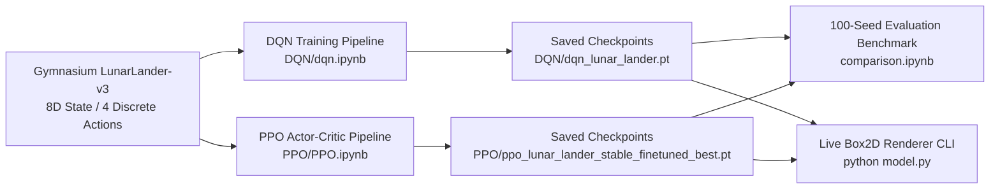

# Start Trek — Deep Reinforcement Learning on LunarLander-v3 (DQN vs. PPO)

Start Trek is a **Deep Reinforcement Learning** benchmark comparing value-based (**Deep Q-Network — DQN**) and policy-gradient (**Proximal Policy Optimization — PPO**) agents trained in PyTorch on the Gymnasium **`LunarLander-v3`** environment.

Both agents exceed the official environment solving threshold of **200+ points** across a deterministic 100-episode evaluation suite.

---

## Key Features & Results

- **Unified Evaluation Protocol (`comparison.ipynb`):**
  - Evaluates both trained agents greedily (without exploration noise) across the exact same **100 fixed episode seeds (`50000`–`50099`)**.
- **Neural Network Architectures (`model.py`):**
  - **DQN:** 3-layer MLP (`state_size → hidden_size → hidden_size → action_size`) with `ReLU` activations, Experience Replay buffer, and target network synchronization.
  - **PPO (Actor-Critic):** Decoupled 3-layer Actor (`Tanh` activations outputting action logits) and 3-layer Critic (`Tanh` activations outputting state value $V(s)$) trained with clipped surrogate objective and Generalized Advantage Estimation (GAE).
- **Real-Time Visual Inference CLI (`model.py`):**
  - Renders trained DQN or PPO checkpoints live in a `LunarLander-v3` Box2D window and logs episode returns.

### Benchmark Performance (100 Episodes, Seeds `50000`–`50099`)

| Algorithm | Architecture | Target Threshold | Mean Score (100 Seeds) | Status |
| :--- | :--- | :---: | :---: | :---: |
| **DQN** | 3-Layer MLP (`ReLU`) | `200.00` | **`249.45`** | Solved |
| **PPO** | Decoupled Actor-Critic (`Tanh`) | `200.00` | **`230.06`** | Solved |

---

## Architecture & Workflow



---

## Project Structure

```text
starttrek/
├── DQN/
│   ├── dqn.ipynb                                      # DQN implementation, training & ablation experiments
│   ├── dqn_lunar_lander.pt                            # Final trained DQN weights
│   ├── models/                                        # Seed & learning-rate ablation checkpoints (.pt)
│   └── results/                                       # JSON training logs and evaluation metrics
├── PPO/
│   ├── PPO.ipynb                                      # PPO Actor-Critic implementation, training & fine-tuning
│   ├── ppo_lunar_lander.pt                            # Base trained PPO checkpoint
│   ├── ppo_lunar_lander_from_scratch_best.pt          # Best from-scratch PPO checkpoint
│   ├── ppo_lunar_lander_finetuned_best.pt             # Fine-tuned PPO checkpoint
│   ├── ppo_lunar_lander_stable_best.pt                # Stable policy PPO checkpoint
│   └── ppo_lunar_lander_stable_finetuned_best.pt      # Best production PPO checkpoint
├── comparison.ipynb                                   # Side-by-side 100-seed benchmark without retraining
├── model.py                                           # CLI runner to watch trained DQN or PPO agents play live
├── random_agent.py                                    # Baseline random-action agent for LunarLander-v3
├── requirements.txt                                   # Locked Python & PyTorch dependencies
└── README.md
```

---

## Installation & Setup

Requires **Python 3.12+** and **SWIG** (for building `Box2D`).

1. **Install system dependencies:**

   - **macOS:**
     ```bash
     brew install swig
     ```
   - **Ubuntu / Debian:**
     ```bash
     sudo apt install python3-venv build-essential swig
     ```

2. **Clone the repository and set up the virtual environment:**

```bash
git clone https://github.com/AlexandrG1209/starttrek.git
cd starttrek
python3 -m venv .venv
source .venv/bin/activate
python -m pip install --upgrade pip setuptools wheel
python -m pip install --no-build-isolation -r requirements.txt
```

---

## Usage

### 1. Watch a Trained Agent Play Live

Run either the DQN or PPO checkpoint in a rendered `LunarLander-v3` window (pass an optional episode count at the end):

```bash
# Run DQN agent
python model.py dqn DQN/dqn_lunar_lander.pt 3

# Run PPO agent
python model.py ppo PPO/ppo_lunar_lander_stable_finetuned_best.pt 3

# Display CLI help
python model.py -h
```

### 2. Explore the Jupyter Notebooks

```bash
jupyter lab
```

- **`comparison.ipynb`:** Loads the saved checkpoints and reproduces the 100-seed comparative evaluation and plots immediately without retraining.
- **`DQN/dqn.ipynb`:** Loads saved experiment logs by default (set `RETRAIN = True` to re-run training).
- **`PPO/PPO.ipynb`:** Full PPO training and fine-tuning pipeline.

---

## Tech Stack

- **Language:** Python 3.12+
- **Deep Learning:** `PyTorch` (`torch`)
- **RL Environment:** `Gymnasium` (`gymnasium[box2d]`)
- **Analysis & Visualization:** `numpy`, `matplotlib`, `jupyterlab`

---

## Contributors

- **Alexandr Gorlachev** (PPO Training & Fine-Tuning) — [@AlexandrG1209](https://github.com/AlexandrG1209)
- **Erwan Aboue** (DQN Training & Experiments) — [@erwanaboue-a11y](https://github.com/erwanaboue-a11y)
